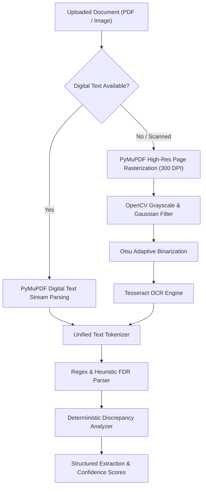

# AICTE FDR Portal — AI & Document Processing Architecture

## 1. Overview
The **AI Document Processing Service** is a dedicated Python FastAPI service designed to parse scanned and digital Fixed Deposit Receipts (FDRs), extract key parameters, calculate extraction confidence, and perform deterministic discrepancy checks.

> [!IMPORTANT]
> **Regulatory Boundary**: AI does not certify financial authenticity or approve release requests. It functions solely as an extraction and audit assistant to flag potential human errors, forged figures, or tenor mismatches. Human scrutiny officers retain sole statutory authority.

---

## 2. Ingestion & Preprocessing Pipeline

---

## 3. Preprocessing Techniques (OpenCV)
When documents are uploaded as mobile camera photos or low-resolution flatbed scans, noise reduction and binarization are critical:
1. **Grayscale Conversion**: Reduces colour artifacts.
2. **Gaussian Blurring (`cv2.GaussianBlur`)**: Removes salt-and-pepper scan noise without dulling text edge contrast.
3. **Otsu Thresholding (`cv2.THRESH_BINARY + cv2.THRESH_OTSU`)**: Automatically computes the optimal threshold separating document background from printed text ink.

---

## 4. Extraction Logic & Regex Heuristics
Tuned specifically for Indian banking practices and AICTE Approval Process Handbook (APH) compliance:
- **Bank Recognition**: Recognizes public and private sector banks (SBI, PNB, Canara Bank, HDFC, ICICI, Bank of Baroda, etc.).
- **FDR Numbers**: Matches alphanumeric receipt and term deposit account numbers.
- **Deposit Amounts**: Handles Indian numeric formatting (e.g. `15,00,000.00`) and verbal expressions (`Rupees Fifteen Lakh Only`).
- **IFSC Codes**: Regex validation for 11-character RBI IFSC codes (`[A-Z]{4}0[A-Z0-9]{6}`).
- **Maturity Dates**: Extracted and verified to be strictly after issue dates.
- **Joint Custody Clauses**: Flags whether "Regional Officer, AICTE" is present as joint account holder.

---

## 5. Discrepancy Scoring
- **HIGH Severity**: Any mismatch between institution-submitted amount and document receipt amount, or bank/FDR number differences.
- **MEDIUM Severity**: Maturity date differences or unreadable IFSC codes.
- **LOW Severity**: Minor branch naming or whitespace formatting variations.

