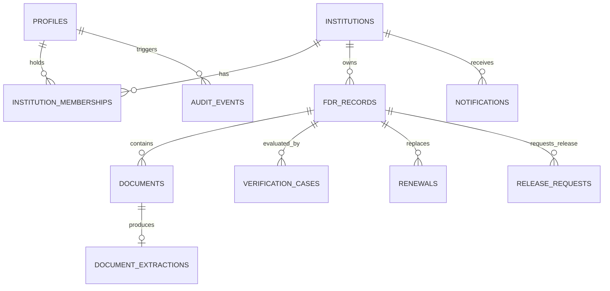

# AICTE FDR Portal — Database Schema Specification

## 1. Overview
The database schema is implemented in Supabase PostgreSQL using strict relational modeling, UUID primary keys, check constraints, foreign keys with referential integrity, and timestamp auditing.

---

## 2. Entity Relationship Diagram (Conceptual)

---

## 3. Detailed Table Specifications

### 3.1 `profiles`
Extends `auth.users` to maintain application-level profiles.
- `id` (UUID, PK, FK -> `auth.users.id` on delete cascade)
- `email` (VARCHAR(255), NOT NULL)
- `full_name` (VARCHAR(255), NOT NULL)
- `phone` (VARCHAR(32))
- `system_role` (VARCHAR(50), NOT NULL: `'institution_user'`, `'scrutiny_officer'`, `'approving_authority'`, `'administrator'`)
- `is_active` (BOOLEAN, DEFAULT true)
- `created_at` (TIMESTAMPTZ, DEFAULT now())
- `updated_at` (TIMESTAMPTZ, DEFAULT now())

### 3.2 `institutions`
Stores accredited technical education institutions.
- `id` (UUID, PK, DEFAULT gen_random_uuid())
- `aicte_id` (VARCHAR(64), UNIQUE, NOT NULL)
- `name` (VARCHAR(255), NOT NULL)
- `institution_type` (VARCHAR(100), NOT NULL) -- Engineering, Management, Pharmacy, Architecture, etc.
- `state` (VARCHAR(100), NOT NULL)
- `city` (VARCHAR(100), NOT NULL)
- `address` (TEXT)
- `contact_email` (VARCHAR(255), NOT NULL)
- `contact_phone` (VARCHAR(32))
- `status` (VARCHAR(50), DEFAULT 'active')
- `created_at` (TIMESTAMPTZ, DEFAULT now())
- `updated_at` (TIMESTAMPTZ, DEFAULT now())

### 3.3 `institution_memberships`
Explicit many-to-many relationship mapping users to institutions with scoped roles.
- `id` (UUID, PK, DEFAULT gen_random_uuid())
- `user_id` (UUID, NOT NULL, FK -> `profiles.id`)
- `institution_id` (UUID, NOT NULL, FK -> `institutions.id`)
- `role` (VARCHAR(50), DEFAULT 'institution_admin')
- `created_at` (TIMESTAMPTZ, DEFAULT now())
- UNIQUE(`user_id`, `institution_id`)

### 3.4 `fdr_records`
The central financial instrument ledger.
- `id` (UUID, PK, DEFAULT gen_random_uuid())
- `institution_id` (UUID, NOT NULL, FK -> `institutions.id`)
- `fdr_number` (VARCHAR(100), NOT NULL)
- `bank_name` (VARCHAR(255), NOT NULL)
- `branch_name` (VARCHAR(255), NOT NULL)
- `ifsc_code` (VARCHAR(16), NOT NULL)
- `amount` (NUMERIC(14, 2), NOT NULL CHECK (amount > 0)) -- Never use floating point for currency!
- `currency` (VARCHAR(3), DEFAULT 'INR')
- `issue_date` (DATE, NOT NULL)
- `maturity_date` (DATE, NOT NULL CHECK (maturity_date > issue_date))
- `joint_holder_name` (VARCHAR(255) DEFAULT 'Regional Officer, AICTE')
- `lifecycle_status` (VARCHAR(50), NOT NULL DEFAULT 'ACTIVE') -- 'ACTIVE', 'MATURED', 'REPLACED', 'RELEASED'
- `review_status` (VARCHAR(50), NOT NULL DEFAULT 'SUBMITTED') -- 'DRAFT', 'SUBMITTED', 'UNDER_SCRUTINY', 'NEEDS_CORRECTION', 'ACCEPTED', 'REJECTED'
- `verification_status` (VARCHAR(50), NOT NULL DEFAULT 'PENDING') -- 'PENDING', 'AUTO_CHECKED', 'INDEPENDENT_PENDING', 'VERIFIED', 'DISCREPANCY_FLAGGED', 'UNABLE_TO_VERIFY'
- `predecessor_fdr_id` (UUID, NULL, FK -> `fdr_records.id`)
- `submitted_by` (UUID, NOT NULL, FK -> `profiles.id`)
- `created_at` (TIMESTAMPTZ, DEFAULT now())
- `updated_at` (TIMESTAMPTZ, DEFAULT now())

### 3.5 `documents`
Metadata for uploaded FDR certificates and bank confirmations.
- `id` (UUID, PK, DEFAULT gen_random_uuid())
- `institution_id` (UUID, NOT NULL, FK -> `institutions.id`)
- `fdr_id` (UUID, NULL, FK -> `fdr_records.id`)
- `document_type` (VARCHAR(50), NOT NULL) -- 'FDR_RECEIPT', 'JOINT_CONFIRMATION_LETTER', 'BANK_STATEMENT', 'RELEASE_ORDER'
- `storage_path` (TEXT, NOT NULL)
- `file_name` (VARCHAR(255), NOT NULL)
- `mime_type` (VARCHAR(100), NOT NULL)
- `file_size` (BIGINT, NOT NULL)
- `sha256_hash` (VARCHAR(64), NOT NULL)
- `document_version` (INT DEFAULT 1)
- `processing_status` (VARCHAR(50), DEFAULT 'PENDING') -- 'PENDING', 'PROCESSING', 'COMPLETED', 'FAILED'
- `uploaded_by` (UUID, NOT NULL, FK -> `profiles.id`)
- `created_at` (TIMESTAMPTZ, DEFAULT now())

### 3.6 `document_extractions`
Structured output from the Python OCR and AI pipeline.
- `id` (UUID, PK, DEFAULT gen_random_uuid())
- `document_id` (UUID, NOT NULL, FK -> `documents.id`)
- `fdr_id` (UUID, NULL, FK -> `fdr_records.id`)
- `extractor_name` (VARCHAR(100), NOT NULL) -- 'tesseract_pymupdf_v1'
- `extractor_version` (VARCHAR(20), NOT NULL)
- `extracted_fields` (JSONB, NOT NULL) -- { fdr_number, bank_name, amount, issue_date, maturity_date, ifsc }
- `confidence_scores` (JSONB, NOT NULL) -- { fdr_number: 0.98, amount: 0.95, ... }
- `page_references` (JSONB)
- `bounding_boxes` (JSONB)
- `errors_warnings` (TEXT[])
- `processing_status` (VARCHAR(50), DEFAULT 'COMPLETED')
- `created_at` (TIMESTAMPTZ, DEFAULT now())

### 3.7 `verification_cases`
Officer scrutiny session records.
- `id` (UUID, PK, DEFAULT gen_random_uuid())
- `fdr_id` (UUID, NOT NULL, FK -> `fdr_records.id`)
- `review_status` (VARCHAR(50), NOT NULL)
- `assigned_officer_id` (UUID, NULL, FK -> `profiles.id`)
- `submitted_snapshot` (JSONB, NOT NULL)
- `extracted_snapshot` (JSONB)
- `discrepancy_summary` (JSONB)
- `independent_evidence_notes` (TEXT)
- `observations` (TEXT)
- `decision` (VARCHAR(50)) -- 'ACCEPT', 'REJECT', 'RETURN_FOR_CORRECTION', 'FLAG_DISCREPANCY'
- `decision_reason` (TEXT)
- `decision_at` (TIMESTAMPTZ)
- `officer_id` (UUID, NULL, FK -> `profiles.id`)
- `created_at` (TIMESTAMPTZ, DEFAULT now())
- `updated_at` (TIMESTAMPTZ, DEFAULT now())

### 3.8 `renewals`
Tracks replacement instruments linked to predecessors.
- `id` (UUID, PK, DEFAULT gen_random_uuid())
- `original_fdr_id` (UUID, NOT NULL, FK -> `fdr_records.id`)
- `replacement_fdr_id` (UUID, NOT NULL, FK -> `fdr_records.id`)
- `reason` (TEXT, NOT NULL)
- `submission_date` (DATE NOT NULL DEFAULT CURRENT_DATE)
- `status` (VARCHAR(50), DEFAULT 'ACTIVE')
- `created_at` (TIMESTAMPTZ, DEFAULT now())

### 3.9 `release_requests`
Formal multi-tier workflow for encashment or return of deposits.
- `id` (UUID, PK, DEFAULT gen_random_uuid())
- `institution_id` (UUID, NOT NULL, FK -> `institutions.id`)
- `fdr_id` (UUID, NOT NULL, FK -> `fdr_records.id`)
- `request_type` (VARCHAR(50), NOT NULL) -- 'PROGRAM_CLOSURE', 'COURSE_DISCONTINUATION', 'DEPOSIT_PERIOD_EXPIRED'
- `justification` (TEXT, NOT NULL)
- `workflow_status` (VARCHAR(50), DEFAULT 'SUBMITTED') -- 'SUBMITTED', 'UNDER_REVIEW', 'AWAITING_CLARIFICATION', 'RECOMMENDED', 'APPROVED', 'REJECTED', 'RELEASE_RECORDED'
- `assigned_reviewer_id` (UUID, NULL, FK -> `profiles.id`)
- `recommendation` (TEXT)
- `approval_decision` (VARCHAR(50))
- `decision_reason` (TEXT)
- `approved_by` (UUID, NULL, FK -> `profiles.id`)
- `approved_at` (TIMESTAMPTZ)
- `bank_release_ref` (VARCHAR(100))
- `created_at` (TIMESTAMPTZ, DEFAULT now())
- `updated_at` (TIMESTAMPTZ, DEFAULT now())

### 3.10 `notifications`
Deadlines, reminders, and workflow status messages.
- `id` (UUID, PK, DEFAULT gen_random_uuid())
- `recipient_id` (UUID, NOT NULL, FK -> `profiles.id`)
- `institution_id` (UUID, NULL, FK -> `institutions.id`)
- `fdr_id` (UUID, NULL, FK -> `fdr_records.id`)
- `notification_type` (VARCHAR(50), NOT NULL) -- 'MATURITY_APPROACHING', 'CORRECTION_NEEDED', 'VERIFICATION_APPROVED', 'RELEASE_PROCESSED'
- `title` (VARCHAR(255), NOT NULL)
- `message` (TEXT, NOT NULL)
- `scheduled_at` (TIMESTAMPTZ DEFAULT now())
- `delivery_status` (VARCHAR(50), DEFAULT 'DELIVERED')
- `attempt_count` (INT DEFAULT 1)
- `read_status` (BOOLEAN DEFAULT false)
- `created_at` (TIMESTAMPTZ, DEFAULT now())

### 3.11 `audit_events`
Append-only tamper-evident compliance audit trail.
- `id` (UUID, PK, DEFAULT gen_random_uuid())
- `actor_id` (UUID, NULL, FK -> `profiles.id`)
- `actor_role` (VARCHAR(50), NOT NULL)
- `action` (VARCHAR(100), NOT NULL) -- 'FDR_SUBMITTED', 'VERIFICATION_DECIDED', 'RELEASE_REQUESTED', etc.
- `entity_type` (VARCHAR(50), NOT NULL) -- 'fdr_records', 'documents', 'release_requests'
- `entity_id` (UUID, NOT NULL)
- `correlation_id` (VARCHAR(100))
- `before_state` (JSONB)
- `after_state` (JSONB)
- `outcome` (VARCHAR(20), NOT NULL) -- 'SUCCESS', 'FAILURE'
- `reason` (TEXT)
- `ip_address` (VARCHAR(64))
- `created_at` (TIMESTAMPTZ, DEFAULT now())

