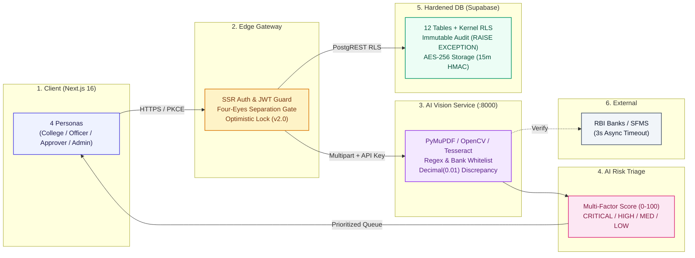
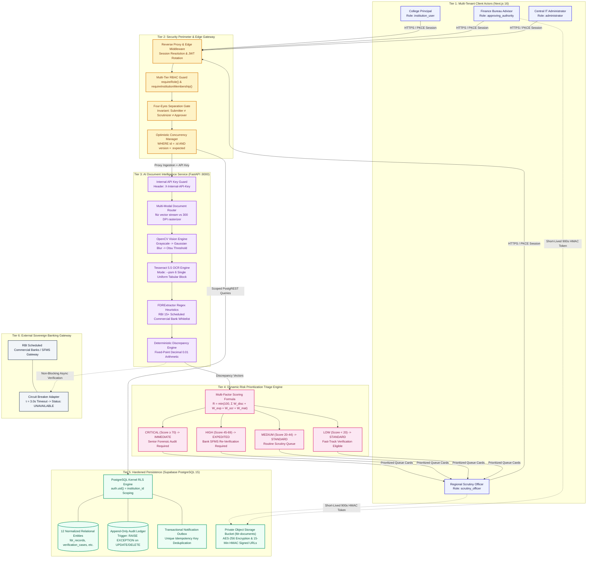
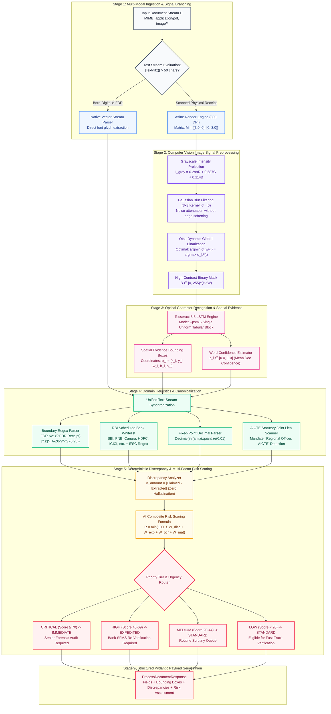

# AICTE SANCHAY (FDRSetu / LienDocket) &bull; Master Mermaid Diagrams

This document contains the official Mermaid diagram definitions for both the **System Architecture** and the **AI Document Intelligence & Risk Triage Pipeline**. Both compact and detailed research-grade formats are provided.

---

## 1. Compact System Architecture Diagram (Recommended for Slides & Readmes)

---

## 2. Compact ML & Document Intelligence Pipeline Diagram

```mermaid
flowchart LR
    %% COLOR DEFINITIONS
    classDef cIn fill:#F8FAFC,stroke:#475569,stroke-width:1.5px,color:#0F172A;
    classDef cCV fill:#F5F3FF,stroke:#8B5CF6,stroke-width:1.5px,color:#4C1D95;
    classDef cOCR fill:#FDF2F8,stroke:#EC4899,stroke-width:1.5px,color:#831843;
    classDef cNLP fill:#ECFDF5,stroke:#10B981,stroke-width:1.5px,color:#064E3B;
    classDef cMath fill:#FFFBEB,stroke:#F59E0B,stroke-width:1.5px,color:#78350F;
    classDef cOut fill:#FFF1F2,stroke:#F43F5E,stroke-width:1.5px,color:#881337;

    IN["1. Ingestion\nPDF Vector / 300 DPI"] --> CV["2. OpenCV Vision\nGray -> Gaussian -> Otsu"]
    CV --> OCR["3. Tesseract 5.5\nPSM 6 + Bounding Boxes"]
    OCR --> NLP["4. Domain Parsing\nRegex + Bank List + Lien"]
    NLP --> MATH["5. Discrepancy & Triage\nDecimal Delta + Risk Score R"]
    MATH --> OUT["6. Action Tiers\nCRITICAL / HIGH / MED / LOW\n(Pydantic Payload)"]

    class IN cIn;
    class CV cCV;
    class OCR cOCR;
    class NLP cNLP;
    class MATH cMath;
    class OUT cOut;
```

---

## 3. Detailed Research-Grade System Architecture Diagram

---

## 4. Detailed Research-Grade ML Pipeline Diagram

---

## 5. Associated Export Files

All corresponding vector graphics and high-resolution raster images are saved alongside this file:
- **System Architecture SVG**: [`docs/diagrams/system-architecture.svg`](file:///Users/vaibhavkrishnakesarwani/Desktop/FDRPROJECT/docs/diagrams/system-architecture.svg)
- **System Architecture PNG (2880 × 2040)**: [`docs/diagrams/system-architecture.png`](file:///Users/vaibhavkrishnakesarwani/Desktop/FDRPROJECT/docs/diagrams/system-architecture.png)
- **ML Pipeline SVG**: [`docs/diagrams/ml-pipeline.svg`](file:///Users/vaibhavkrishnakesarwani/Desktop/FDRPROJECT/docs/diagrams/ml-pipeline.svg)
- **ML Pipeline PNG (2880 × 2040)**: [`docs/diagrams/ml-pipeline.png`](file:///Users/vaibhavkrishnakesarwani/Desktop/FDRPROJECT/docs/diagrams/ml-pipeline.png)
