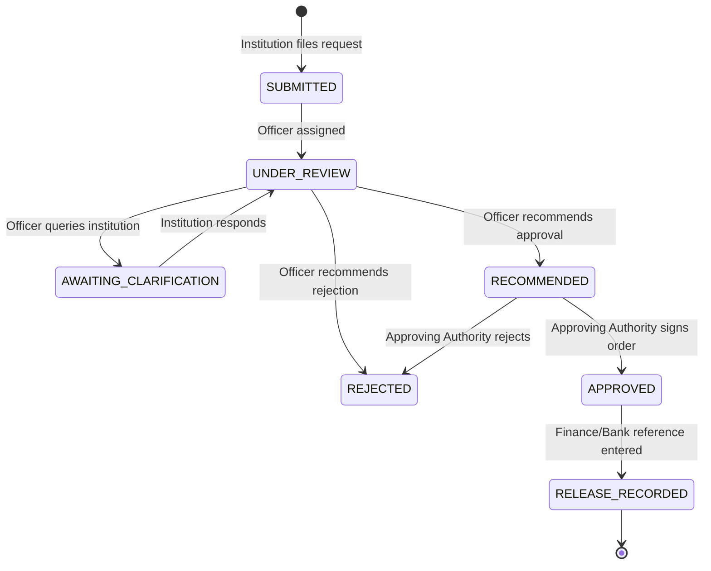

# AICTE FDR Portal — Workflow State Machines & AI Pipeline

## 1. Instrument Lifecycle vs. Administrative Review

A critical architecture requirement is maintaining clear separation between:
1. **Instrument Lifecycle Status** (Physical financial instrument reality):
   - `ACTIVE`: Valid deposited FDR held in joint custody.
   - `MATURED`: Date reached maturity without release/renewal yet processed.
   - `REPLACED`: Superseded by a renewal/replacement instrument.
   - `RELEASED`: Closed and proceeds refunded/released per AICTE order.

2. **Administrative Review Status** (AICTE compliance review):
   - `DRAFT`: Form saved by institution, not yet finalized.
   - `SUBMITTED`: Form submitted, queued for scrutiny.
   - `UNDER_SCRUTINY`: Scrutiny officer opened workbench and review is ongoing.
   - `NEEDS_CORRECTION`: Returned to institution with specific observation comments.
   - `ACCEPTED`: Scrutiny officer confirmed documents match requirements.
   - `REJECTED`: Formal rejection on statutory or invalid grounds.

3. **Independent Verification Status** (AI & OCR cross-check):
   - `PENDING`: Awaiting AI document processing.
   - `AUTO_CHECKED`: Text extracted, deterministic validation done.
   - `INDEPENDENT_PENDING`: Discrepancy detected or manual branch confirmation needed.
   - `VERIFIED`: Fields match perfectly and verified.
   - `DISCREPANCY_FLAGGED`: Discrepancy highlighted for officer attention.

---

## 2. Release / Refund State Machine

---

## 3. Python AI Document Processing Architecture

The Python microservice acts as an intelligent extraction copilot:
1. **File Ingestion**: Receives PDF or image via secure authenticated API.
2. **Text Extraction**:
   - For searchable PDFs: PyMuPDF parses digital text streams with font and layout metadata.
   - For scanned PDFs or images: PyMuPDF rasterizes pages at 300 DPI, OpenCV applies grayscale conversion, noise filtering, and adaptive thresholding, then Tesseract OCR extracts text blocks and confidence scores.
3. **FDR Pattern Parsing**:
   - FDR numbers (alphanumeric sequences, e.g. `FDR-2024-88412`, `SBIN9940129384`).
   - Bank names (SBI, HDFC Bank, Punjab National Bank, Canara Bank, ICICI Bank, Bank of Baroda, etc.).
   - Amount in numbers (`₹ 15,00,000.00`) and words (`Rupees Fifteen Lakh Only`).
   - Issue Date and Maturity Date.
   - IFSC Codes (`SBIN0001234`, `HDFC0000456`).
4. **Deterministic Discrepancy Analysis**:
   Compares Institution Submitted Values with Extracted Values:
   - Match (Confidence 1.0)
   - Tolerable Formatting Difference (e.g., date formatted `DD/MM/YYYY` vs `YYYY-MM-DD`)
   - Material Discrepancy (e.g., amount entered is 15,00,000 but receipt shows 10,00,000) -> Flags severity `HIGH`.
