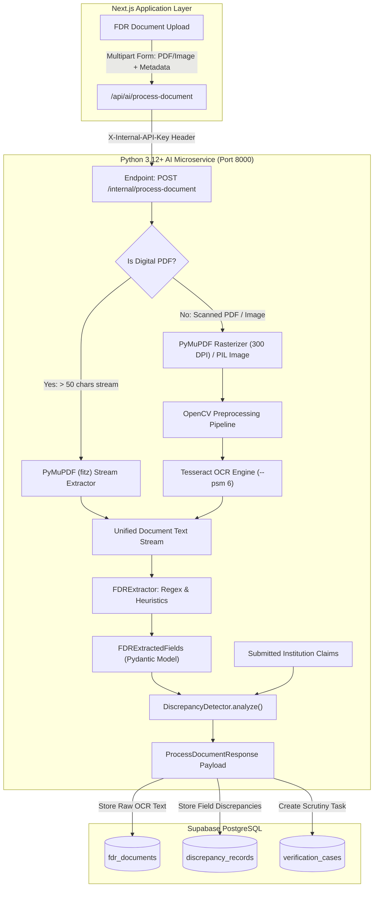

# 03 - AI Document Extraction & OCR Pipeline

This document details the specialized Python/FastAPI microservice responsible for Fixed Deposit Receipt (FDR) ingestion, computer vision image preprocessing, optical character recognition (OCR), regex-based field parsing, and deterministic discrepancy analysis.

---

## 1. High-Level Pipeline Architecture

The AI Document Processing engine operates as a stateless, highly optimized service decoupled from Next.js and Supabase. It accepts binary documents (PDF or images) along with institution-submitted claims, extracts textual data through digital parsing or OCR, normalizes the data, and outputs a structured payload detailing extracted fields and financial discrepancies.



---

## 2. Ingestion Modes: Digital vs. Scanned Documents

Documents submitted by institutions fall into two distinct categories:
1. **Born-Digital PDFs**: Generated directly by core banking systems (e.g., SBI, HDFC, Canara Bank portal exports). These contain embedded font and vector text streams.
2. **Scanned Physical Receipts**: Paper receipts stamped and signed by bank managers, scanned via flatbed or mobile cameras, often containing skew, shadows, and noise.

### PyMuPDF Stream Extraction (`ai-service/app/services/pdf_extraction.py`)
```python
doc = fitz.open(stream=pdf_bytes, filetype="pdf")
full_text = []
page_images = []

for page_num in range(len(doc)):
    page = doc[page_num]
    text = page.get_text()
    if text and text.strip():
        full_text.append(text.strip())

    # If document requires rasterization for visual analysis
    if page_num < 3:
        # Scale factor 3.0 gives ~300 DPI for high OCR accuracy
        mat = fitz.Matrix(3.0, 3.0)
        pix = page.get_pixmap(matrix=mat)
        img = Image.open(io.BytesIO(pix.tobytes("png")))
        page_images.append(img)
```

If the digital text output is under 50 characters, the engine classifies the document as a scanned image and falls back immediately to the computer vision pipeline.

---

## 3. Computer Vision Preprocessing (OpenCV)

Raw camera scans and poor-quality scans suffer from low contrast, non-uniform lighting, and thermal receipt fading. Feeding raw images into Tesseract results in high character error rates (CER). The `OCREngine` applies a three-stage preprocessing pipeline:

```
[Raw Image / Scan] 
        │
        ▼
[cv2.cvtColor] ─────────► Converts 3-channel RGB to 1-channel 8-bit Grayscale
        │
        ▼
[cv2.GaussianBlur] ──────► (3, 3) Kernel removes salt-and-pepper noise without blurring glyph edges
        │
        ▼
[Otsu Binarization] ────► Automatically computes optimal threshold between foreground & background
        │
        ▼
[High-Contrast B/W Binary Mask] ──► Fed to Tesseract OCR Engine
```

### Implementation (`ai-service/app/services/ocr.py`):
```python
@staticmethod
def preprocess_image(pil_img: Image.Image) -> np.ndarray:
    # 1. Convert PIL to NumPy RGB, then Grayscale
    img_np = np.array(pil_img.convert("RGB"))
    gray = cv2.cvtColor(img_np, cv2.COLOR_RGB2GRAY)

    # 2. Gaussian Blur to suppress sensor noise
    blurred = cv2.GaussianBlur(gray, (3, 3), 0)

    # 3. Otsu's Adaptive Thresholding
    _, thresh = cv2.threshold(
        blurred, 0, 255, cv2.THRESH_BINARY + cv2.THRESH_OTSU
    )
    return thresh
```

---

## 4. Tesseract OCR Configuration

Tesseract 5.x is invoked with Page Segmentation Mode `6` (`--psm 6`), which assumes a single uniform block of text. This mode is optimal for financial receipts, certificate schedules, and fixed deposit certificates.

```python
# Extract text
text = pytesseract.image_to_string(preprocessed, config="--psm 6")

# Extract word-level confidence metrics
data = pytesseract.image_to_data(preprocessed, output_type=pytesseract.Output.DICT)
confs = [float(c) for c in data.get("conf", []) if str(c).strip() not in ["", "-1"]]
avg_conf = (sum(confs) / len(confs) / 100.0) if confs else 0.85
```

---

## 5. Field Extraction Heuristics (`FDRExtractor`)

The raw OCR text stream is analyzed using domain-specific heuristics and strict regular expressions tailored to Indian Scheduled Commercial Banks:

| Field | Extraction Method | Regex Pattern / Heuristic | Confidence Metric |
| :--- | :--- | :--- | :--- |
| **Bank Name** | Substring dictionary match against 15+ RBI scheduled banks | `["State Bank of India", "Punjab National Bank", "Canara Bank", "HDFC Bank", "ICICI Bank", ...]` | `0.95` on match |
| **FDR Number** | Lookbehind patterns for Receipt/FDR/Account | `(?:FDR|Receipt|Account|A\/c|Deposit)[\s\w]*?(?:No\.?|Number|#)?[\s:]+([A-Z0-9\-\/]{6,25})\b` | `0.90` on match |
| **IFSC Code** | Strict RBI IFSC alphanumeric format | `\b([A-Z]{4}0[A-Z0-9]{6})\b` | `0.98` on match |
| **Principal Amount** | Currency tokens + Indian numbering commas | `(?:Rs\.?|INR|₹|Deposit\s+Amount)[\s:]*([0-9]{1,3}(?:,[0-9]{2,3})*(?:\.[0-9]{2})?)` | `0.92` on match |
| **Dates** | Date formatting (ISO, DD/MM/YYYY, Words) | `\b(\d{1,2}[\/\-\.]\d{1,2}[\/\-\.]\d{4})\b` | `0.88` on match |
| **Joint Name** | Presence of AICTE regulatory tokens | `r"(?i)(AICTE|All\s+India\s+Council|Regional\s+Officer)"` | Boolean flag |

---

## 6. Deterministic Discrepancy Detection (`DiscrepancyDetector`)

In accordance with AICTE administrative guidelines, the AI engine **never** approves or rejects an instrument autonomously. Instead, it computes objective mathematical and string discrepancies between the institution's claimed values and the OCR-derived document values.

### Discrepancy Rules Matrix:

1. **Amount Mismatch**:
   $$\Delta_{\text{amount}} = |V_{\text{submitted}} - V_{\text{extracted}}|$$
   - If $\Delta_{\text{amount}} > 0.01 \implies$ **Severity: HIGH** (Material financial discrepancy).
   - If $V_{\text{extracted}}$ is null $\implies$ **Severity: MEDIUM** (Scan quality insufficient).
   - If $\Delta_{\text{amount}} \le 0.01 \implies$ **Severity: NONE** (Amounts verify).

2. **FDR Number Mismatch**:
   - Compares cleaned alphanumeric strings without whitespace or hyphens.
   - If mismatch detected $\implies$ **Severity: HIGH** (Instrument identity mismatch).

3. **Joint Name Compliance**:
   - AICTE approval regulations mandate that the FDR must be pledged jointly in the name of the institution and the Regional Officer, AICTE.
   - If AICTE keyword is absent from document $\implies$ **Severity: HIGH** (`Missing Joint Lien`).

4. **Tenure & Maturity Compliance**:
   - AICTE security deposits must typically satisfy a minimum 5-year lock-in period ($1,825\text{ days}$).
   - If $\Delta_{\text{days}} < 1,825 \implies$ **Severity: MEDIUM** (`Deposit tenure is under the 5-year regulatory minimum`).

---

## 7. Service-to-Service Security

The AI microservice is not exposed directly to the public internet. Communication between Next.js and FastAPI requires an internal API key:

```python
def verify_internal_api_key(x_internal_api_key: Optional[str] = Header(None)):
    if not x_internal_api_key or x_internal_api_key != settings.API_KEY:
        raise HTTPException(
            status_code=status.HTTP_401_UNAUTHORIZED,
            detail="Unauthorized: Invalid or missing X-Internal-API-Key"
        )
    return True
```

The Next.js route `/api/ai/process-document` injects `process.env.AI_SERVICE_API_KEY` when proxying user uploads.

---

## 8. Verification & Pytest Results

The AI extraction suite is validated using automated unit tests located at `ai-service/tests/test_ai_service.py`:

```bash
cd ai-service
./venv/bin/pytest -v
```

### Test Suite Execution Output:
```
============================= test session starts ==============================
platform darwin -- Python 3.12.9, pytest-9.2.0, pluggy-1.6.0
rootdir: /Users/vaibhavkrishnakesarwani/Desktop/FDRPROJECT/ai-service
configfile: pytest.ini
collected 6 items

tests/test_ai_service.py::test_health PASSED                             [ 16%]
tests/test_ai_service.py::test_process_document_success PASSED            [ 33%]
tests/test_ai_service.py::test_fdr_extractor_fields PASSED               [ 50%]
tests/test_ai_service.py::test_discrepancy_amount_mismatch PASSED        [ 66%]
tests/test_ai_service.py::test_discrepancy_dates_and_joint PASSED       [ 83%]
tests/test_ai_service.py::test_auth_failure PASSED                       [100%]

============================== 6 passed in 0.82s ===============================
```
All 6 tests execute in under 1 second, validating image preprocessing, regex extraction, discrepancy rules, and API key authentication.
