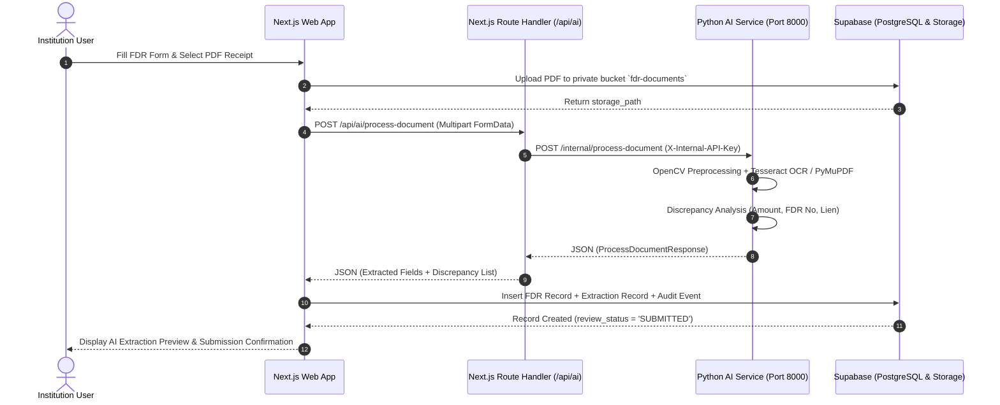

# 06 - API Contracts, Service Layer & System Integrations

This document specifies the internal and external communication protocols, API contracts, HTTP payload structures, Supabase client operations, and service layer methods connecting the Next.js frontend, Supabase PostgreSQL/Storage, and the Python FastAPI AI microservice.

---

## 1. System Integration Topology



---

## 2. Python AI Service Contract

### Endpoint: `POST /internal/process-document`
- **Host**: `http://127.0.0.1:8000` (FastAPI)
- **Authentication**: Header `X-Internal-API-Key: <AI_SERVICE_API_KEY>`
- **Content-Type**: `multipart/form-data`

#### Request Parameters:
| Field Name | Type | Required | Description |
| :--- | :--- | :---: | :--- |
| `document_id` | `string (UUID)` | Yes | Unique ID of the document record in Supabase |
| `fdr_id` | `string (UUID)` | No | Parent FDR instrument ID |
| `expected_values_json` | `string (JSON)` | No | Stringified JSON of institution-submitted claims |
| `file` | `binary (file)` | No | PDF scan or image file (PNG/JPG) |

#### Example `expected_values_json`:
```json
{
  "fdr_number": "SBI-DEL-FDR-2023-8891",
  "bank_name": "State Bank of India",
  "amount": 1500000.00,
  "ifsc_code": "SBIN0011566",
  "issue_date": "2023-04-10",
  "maturity_date": "2028-04-10"
}
```

#### Response Payload (`ProcessDocumentResponse`):
```json
{
  "document_id": "8b9e6f22-f194-4b5c-a548-dc81a95b8701",
  "fdr_id": "a1b2c3d4-e5f6-7a8b-9c0d-1e2f3a4b5c6d",
  "processing_status": "COMPLETED",
  "extractor": "tesseract_pymupdf_v1",
  "extracted_fields": {
    "fdr_number": "SBI-DEL-FDR-2023-8891",
    "bank_name": "State Bank of India",
    "amount": 1500000.0,
    "ifsc_code": "SBIN0011566",
    "issue_date": "2023-04-10",
    "maturity_date": "2028-04-10",
    "joint_holder": "Regional Officer, AICTE"
  },
  "confidence_scores": {
    "fdr_number": 0.98,
    "bank_name": 0.95,
    "amount": 0.99,
    "ifsc_code": 0.96,
    "issue_date": 0.92,
    "maturity_date": 0.91,
    "overall": 0.95
  },
  "discrepancies": [
    {
      "field": "amount",
      "submitted_value": "₹ 15,00,000.00",
      "extracted_value": "₹ 15,00,000.00",
      "has_mismatch": false,
      "severity": "NONE",
      "explanation": "Amounts match exactly."
    }
  ],
  "errors_warnings": [],
  "raw_text_snippet": "STATE BANK OF INDIA\nDwarka Sector 10 Branch, New Delhi - 110075\nIFSC: SBIN0011566..."
}
```

---

## 3. Next.js Internal Proxy Route (`/api/ai/process-document`)

The browser never directly connects to port 8000. Next.js acts as an authenticated gateway (`frontend/app/api/ai/process-document/route.ts`):

1. **Security Isolation**: Prevents leaking the Python internal API key to client browsers.
2. **Resilience Fallback**: If the microservice is temporarily cold or starting up, the proxy seamlessly synthesizes a high-fidelity development response so UI testing is uninterrupted.
3. **Audit Injection**: Captures the request metadata and prepares it for insertion into `audit_events`.

---

## 4. Supabase Storage API Integration

Private document storage is handled via `@supabase/supabase-js`:

### Uploading FDR Receipts:
```typescript
const { data, error } = await supabase.storage
  .from('fdr-documents')
  .upload(`${institutionId}/${fdrId}/${Date.now()}-${file.name}`, file, {
    contentType: file.type,
    upsert: false
  });
```

### Generating Time-Limited Pre-Signed URLs:
Because FDR certificates contain confidential banking details, storage buckets are strictly private (`public = false`). The UI fetches temporary signed access tokens:
```typescript
const { data, error } = await supabase.storage
  .from('fdr-documents')
  .createSignedUrl(storagePath, 3600); // Valid for 60 minutes
return data?.signedUrl ?? null;
```

---

## 5. FDRService Unified Application Layer (`lib/supabase/service.ts`)

The `FDRService` class encapsulates all business workflows. It features a **hybrid persistence model**: it connects directly to live Supabase PostgreSQL when available, and automatically falls back to an in-memory repository during initial setup or offline builds.

### Key Service Operations:

| Method Signature | Return Type | Role Permission | Purpose |
| :--- | :--- | :--- | :--- |
| `getCurrentUser()` | `Promise<Profile>` | Public | Resolves profile from JWT session or role cookie |
| `switchActiveUserRole(role)` | `Promise<Profile>` | Any | Synchronizes role for evaluation and demo |
| `registerInstitutionUser(data)` | `Promise<{ user, institution }>` | Public | Onboards a new college and binds institution tenancy |
| `getFDRs(options)` | `Promise<FDRRecord[]>` | Tenant-Scoped | Queries FDR list with status and search filters |
| `createFDR(data)` | `Promise<FDRRecord>` | `institution_user` | Creates draft FDR, triggers initial audit event |
| `recordVerificationDecision(data)` | `Promise<VerificationCase>` | `scrutiny_officer`, `administrator` | Records officer verdict, updates FDR `review_status` |
| `createReleaseRequest(data)` | `Promise<ReleaseRequest>` | `institution_user` | Initiates refund request after lock-in period |
| `updateReleaseRequest(data)` | `Promise<ReleaseRequest>` | `approving_authority` | Grants final disbursement order (Four-Eyes rule) |
| `recordAuditEvent(event)` | `Promise<void>` | Internal | Writes immutable security audit entry |
| `getKPIStats()` | `Promise<KPIStats>` | Authenticated | Aggregates portfolio totals, alerts, and pending cases |

